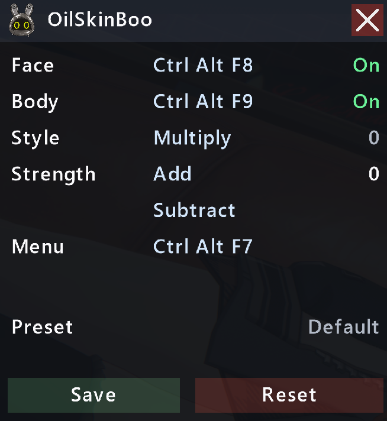

# OilSkinBoo · 油光布

A mod that makes your favorite agent shine

With separate face and body toggles, adjustable intensity, and per-agent presets.

[简体中文](README.zh-CN.md)

OilSkinBoo works with **[OilSkin 2](https://gamebanana.com/mods/741702)** to give supported Zenless Zone Zero agents a glossy, wet look. Use Standard for agent gloss, or Glossify to extend the effect to supported NPCs, Bangboo, enemies, and scene objects.

## Requirements

- **ZZMI**, installed through XXMI Launcher or FlairX Mod Manager.
- **[OilSkin 2 — download on GameBanana](https://gamebanana.com/mods/741702)**. Its extracted folder should contain `Matcap_ZZZ.ini` and an `Oil` folder. The shader and textures are not included here.
- **OilSkinBoo**, from this repository or the [Releases page](https://github.com/IkaGuan/ZZZ-OilSkinBoo/releases).

Fully compatible with FlairX Mod Manager, including hotkey rebinding. Other mod managers haven't been tested. No patcher, Python installation, or compilation is needed.

## Choose your version

| Version | English folder | Chinese folder | Effect |
| --- | --- | --- | --- |
| Standard | `OilSkinBoo` | `油光布` | Gloss on supported agents. NPCs, Bangboo, and enemies stay matte. |
| Glossify / 全油化版 | `OilSkinBoo-Glossify` | `油光布-全油化版` | Agent gloss plus gloss on other models covered by OilSkin's shader, including supported NPCs, Bangboo, enemies, and scene objects. |

**Glossify controls:** Press **Ctrl+Alt+F9** to toggle agent body gloss and gloss on supported NPCs, Bangboo, enemies, and scene objects **together**. Turning **Body** off disables both. **Face** controls supported agent faces independently. Body gloss is off by default.

To keep agent bodies glossy while NPCs stay matte, choose **Standard**. Glossify has no separate NPC-only toggle. Its coverage depends on each object's shader; it does not make every surface glossy.

**Install and enable only one of the four folders.** These are alternative versions and languages of the same mod.

## Installation

1. Download [OilSkin 2](https://gamebanana.com/mods/741702), extract it into `ZZMI\Mods`, and enable it. Disable older or duplicate OilSkin installations.
2. Download and extract OilSkinBoo. On GitHub, use **Code → Download ZIP**, or download a release.
3. Copy **one** folder from the table above into `ZZMI\Mods`. Place it alongside OilSkin 2, not inside it. Do not install the entire repository into Mods.
4. Launch the game through your mod launcher. If it is already running, press **F10** to reload mods.

The first load, or a reload after shader changes, may take several seconds while shaders compile. In FlairX, a folder with the `DISABLED_` prefix is disabled.

## Quick start

1. Open a preview of the agent you want to configure, preferably with no other agents on screen.
2. Press **Ctrl+Alt+F7** to open the menu.
3. Press **Ctrl+Alt+F9** to enable **Body**. **Face** is enabled by default. In Glossify, Body also enables gloss on supported NPCs, Bangboo, enemies, and scene objects.
4. **Click Save before changing the style or intensity** to create a preset for this agent. Otherwise, your adjustments change the shared default.
5. Press **Numpad \*** to select style **1–7**. Style **0** is off; **7** is the water-droplet style.
6. Use **Numpad + / −** to adjust intensity. Try **5** to start.

After the first save, further style and intensity changes update that agent's preset automatically.

### In-game menu

**Menu reference:** This screenshot shows **Style 0** and **Strength 0**, so gloss is disabled even though Face and Body show On. Both style and strength must be above zero for gloss to appear.

Use hotkeys to change **Face**, **Body**, **Style**, and **Strength**. **Save**, **Reset**, and **X** are clickable. Show the game's mouse cursor before clicking or dragging the menu. Drag it to reposition it; close it with **X** or **Ctrl+Alt+F7**.

The screenshot's **Multiply**, **Add**, and **Subtract** labels mean **Numpad \***, **Numpad +**, and **Numpad −**.

## Default hotkeys

| Action | Key | Notes |
| --- | --- | --- |
| Open / close menu | Ctrl+Alt+F7 | Hidden by default |
| Toggle face gloss | Ctrl+Alt+F8 | On by default; supported agent faces |
| Toggle body gloss | Ctrl+Alt+F9 | Off by default; in Glossify, also toggles NPC, Bangboo, enemy, and scene-object gloss |
| Cycle gloss style | Numpad * | Cycles through 0–7; 0 is off |
| Increase intensity | Numpad + | Adds 1; wraps from 10 to 0 |
| Decrease intensity | Numpad − | Subtracts 1; wraps from 0 to 10 |
| Reload mods | F10 | Use after installation or rebinding |

Intensity appears as **Strength**, from **0–10**. Both style and intensity must be above 0. If you have no numpad or a key conflicts, rebind it in **FlairX's hotkey editor**, then press **F10**. The menu displays the new bindings. OilSkinBoo disables OilSkin 2's original numpad bindings to prevent double inputs.

## Per-agent presets

**Save first, then customize.** Agents without a preset share the global default. Adjusting one also changes the default for other unsaved agents.

- **Save** creates a preset for the current agent; the menu displays **Saved**. Later style and intensity changes update it automatically.
- **Reset** deletes this agent's preset and returns them to the global default. It does not disable gloss or reset other agents.
- **Face** and **Body** are global toggles and are not saved per agent. Some official outfits share a preset.

For example, save one agent with style 2 and strength 5, then save another with style 7 and strength 8. Each keeps their own settings. Use a single-agent preview: with several agents visible, adjustments may target the first supported agent rendered.

In Glossify, NPCs and other non-agent models use the current OilSkin style and intensity and do not have individual presets.

## Compatibility and known issues

- **Seth is currently unsupported.**
- Vanilla model support depends on the mesh hashes included in OilSkinBoo. New agents and game updates may require an update.
- Texture-only skin mods can use existing model support. Custom mesh compatibility depends on how the mod is set up. Glossify does not fix unsupported agents or guarantee support for every custom mesh.
- Gloss can affect clothing and accessories in the same supported body mesh; it is not automatically limited to exposed skin.
- Vanilla Rina, Lighter, Caesar, Soldier 0, and Vivian have special handling to keep hair matte while glossing their legs. Ellen's supported hair mesh gets gloss across the entire mesh. Custom meshes may behave differently.
- Face gloss uses a separate effect and may look different from body gloss. It can take a moment to appear when a face first loads.

### Why is the hair glossy with some skin mods?

Some mods combine hair and skin in one mesh or draw call, or draw hair through a part identified as body or legs. Gloss can then affect the hair too. Vanilla fixes may not apply to custom meshes.

Ask the mod author about compatibility, or back up the mod before editing it yourself. Separate hair draw calls may be excluded with an INI edit. Shared hair and skin draw calls may need a mesh edit or custom mask. There is no universal hair toggle. Turning **Body** off can help identify the cause, but also removes body gloss and, in Glossify, non-agent gloss.

## Troubleshooting

| Issue | Try this |
| --- | --- |
| No gloss | Enable ZZMI, OilSkin 2, and exactly one OilSkinBoo variant. Press F10, choose style 1–7, set strength above 0, and enable Face or Body. |
| I want to turn NPC, Bangboo, or enemy gloss off | In Glossify, press Ctrl+Alt+F9 to turn Body off. This also disables agent body gloss; Face stays independent. To keep agent bodies glossy while NPCs stay matte, switch to Standard. |
| Glossify does not affect NPCs or other models | Enable Body, choose a nonzero style, and set strength above 0. Coverage depends on each model's shader. |
| Face works, but body gloss does not | Body starts off. Press Ctrl+Alt+F9. If only a skin mod fails, test the vanilla model. |
| Face gloss appears after a short delay | Keep the face visible briefly while the effect initializes. |
| Numpad keys do not work | If ZZMI's green hunting overlay is visible, press Numpad 0 until it disappears. Check key conflicts or rebind in FlairX, then press F10. |
| Cannot click or drag the menu | Show the game's mouse cursor. Use hotkeys for Face, Body, Style, and Strength. |
| Settings target the wrong agent | Use a preview with only the target agent visible. Save before adjusting. |
| Errors or settings skip a step | Disable duplicate OilSkin installations and extra OilSkinBoo variants or languages. Keep one engine and one variant enabled, then press F10. |
| An agent stops working after an update | Their mesh hashes may have changed. Check for an OilSkinBoo update. |

## Feedback

Bug reports and feature requests are welcome through [GitHub Issues](https://github.com/IkaGuan/ZZZ-OilSkinBoo/issues). Include versions, reproduction steps, expected and actual behavior, and screenshots or full error messages. For feature requests, explain what you want to do and how it would help.

## Updating and uninstalling

Replace your installed OilSkinBoo folder with the new version, keep only one copy enabled, and press **F10**. OilSkin 2 stays installed separately.

To switch versions, disable the current variant, enable one language of the other variant, and press **F10**. Both variants share settings, so switching does not reset them.

To disable or uninstall, turn OilSkinBoo off in your mod manager or remove its folder, then press **F10**. You can also prefix its folder name with `DISABLED_`. Disable OilSkin 2 separately to remove its effects too.

## Credits

- Shader and textures: [OilSkin / OilSkin 2](https://gamebanana.com/mods/741702), a ZZZ port of [KatTDev's Wuthering Waves matcap](https://gamebanana.com/mods/733773). Required separately; not bundled here.
- Mesh hash reference: [ZZ-Model-Importer-Assets](https://github.com/leotorrez/ZZ-Model-Importer-Assets).
