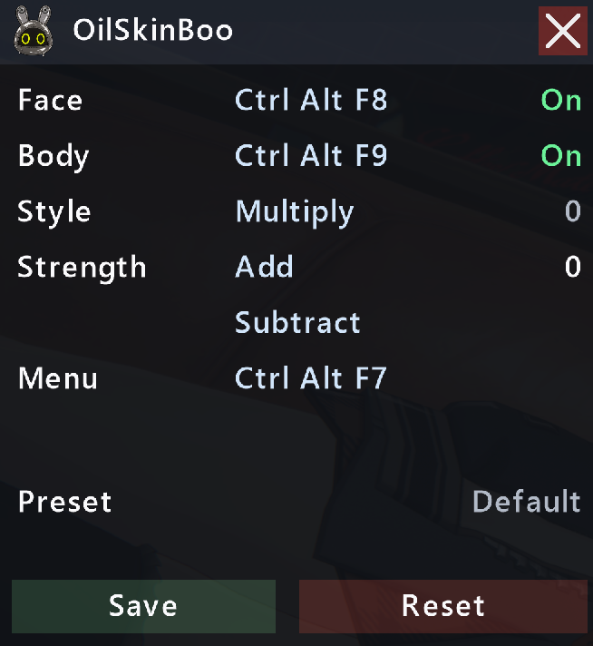

# 油光布 · OilSkinBoo

让你喜爱的代理人闪闪发光的 Mod

支持面部与身体独立开关、光泽强度调节，以及每位代理人的专属预设。

[English](README.md)

<<<<<<< HEAD
油光布配合 **[OilSkin 2](https://gamebanana.com/mods/741702)** 使用，为《绝区零》中已支持的代理人添加油光。标准版只影响代理人；全油化版（Glossify）还可影响受支持的 NPC、邦布、敌人和场景物件。

## 安装前准备

- **ZZMI**：通过 XXMI Launcher 或 FlairX Mod Manager 安装。
- **[OilSkin 2（GameBanana 下载）](https://gamebanana.com/mods/741702)**：解压后应包含 `Matcap_ZZZ.ini` 和 `Oil` 文件夹。本项目不包含其着色器和贴图，需要单独安装。
- **油光布**：从本仓库或[发布页面](https://github.com/IkaGuan/ZZZ-OilSkinBoo/releases)下载。

已完全兼容 FlairX Mod Manager，包括快捷键编辑功能。其他 Mod 管理器尚未验证。无需 Python、补丁工具或编译操作。

## 选择版本

| 版本 | 英文文件夹 | 中文文件夹 | 效果 |
| --- | --- | --- | --- |
| 标准版 | `OilSkinBoo` | `油光布` | 为已支持的代理人添加油光，NPC、邦布和敌人保持哑光。 |
| 全油化版 / Glossify | `OilSkinBoo-Glossify` | `油光布-全油化版` | 保留代理人油光，并扩展至 OilSkin 着色器覆盖的其他模型，包括受支持的 NPC、邦布、敌人和场景物件。 |

**全油化版如何开关 NPC 油光？** 按 **Ctrl+Alt+F9** 切换**身体**开关，即可同时开启或关闭**代理人身体，以及受支持的 NPC、邦布、敌人和场景物件**的油光。关闭身体也会去掉代理人的身体油光。**面部**开关独立控制已支持的代理人面部。身体默认关闭。

如果希望**代理人身体有油光，但 NPC 保持哑光**，请选择**标准版**。全油化版没有独立的 NPC 开关。实际覆盖范围取决于各物件使用的着色器，并非所有表面都会产生油光。

**四个文件夹只安装并启用其中一个。** 它们是同一个 Mod 的不同版本和语言，不能叠加启用。

## 安装方法

1. 下载 [OilSkin 2](https://gamebanana.com/mods/741702)，解压至 `ZZMI\Mods` 并启用。禁用旧版或重复的 OilSkin。
2. 下载并解压油光布。GitHub 可使用 **Code → Download ZIP**，也可下载发布版本。
3. 从上表选择**一个**文件夹，复制到 `ZZMI\Mods`。与 OilSkin 2 并排放置，不要放进 OilSkin 2 文件夹，也不要把整个仓库放入 Mods。
4. 通过 Mod 启动器进入游戏。如果游戏已在运行，按 **F10** 重新加载。

首次加载或修改着色器后重新加载，可能需要几秒钟编译着色器。FlairX 中以 `DISABLED_` 开头的文件夹表示已禁用。

## 第一次使用

1. 打开目标代理人的预览界面，尽量只显示一个代理人。
2. 按 **Ctrl+Alt+F7** 打开面板。
3. 按 **Ctrl+Alt+F9** 开启**身体**油光。**面部**默认开启。全油化版的身体开关还会同时开启受支持的 NPC、邦布、敌人和场景物件油光。
4. **先点击保存，再调整样式和强度**，为当前代理人建立独立预设。否则，调整会改变共用默认设置。
5. 按**小键盘 \*** 选择样式 **1–7**。**0** 表示关闭，**7** 为水滴样式。
6. 用**小键盘 + / −** 调整强度，可以先从 **5** 开始。

保存过一次后，继续调整样式和强度会自动更新该代理人的预设。

### 游戏内面板

**面板示意：** 截图中 **Style（样式）**和 **Strength（强度）**均为 **0**，因此即使 Face 和 Body 显示 On，也不会产生油光。样式与强度都必须大于 0。

面部、身体、样式和强度通过快捷键调整；**保存（Save）**、**重置（Reset）**和 **X** 可以点击。先让游戏显示鼠标光标，再点击或拖动面板。拖动可调整位置，按 **Ctrl+Alt+F7** 或点击 **X** 关闭。

截图中的 **Multiply**、**Add**、**Subtract** 分别指**小键盘 \***、**小键盘 +**、**小键盘 −**。

## 默认快捷键

| 操作 | 按键 | 说明 |
| --- | --- | --- |
| 显示／隐藏面板 | Ctrl+Alt+F7 | 默认隐藏 |
| 面部油光开关 | Ctrl+Alt+F8 | 默认开启，控制已支持的代理人面部 |
| 身体油光开关 | Ctrl+Alt+F9 | 默认关闭；全油化版中也控制 NPC、邦布、敌人和场景物件油光 |
| 切换样式 | 小键盘 * | 在 0–7 间循环，0 为关闭 |
| 增加强度 | 小键盘 + | 每次增加 1，10 之后回到 0 |
| 降低强度 | 小键盘 − | 每次减少 1，0 之后回到 10 |
| 重新加载 Mod | F10 | 安装或修改快捷键后使用 |

强度在英文面板显示为 **Strength**，范围为 **0–10**。样式与强度都大于 0 时才能看到效果。如果没有小键盘或按键冲突，可在 **FlairX 的快捷键编辑器**中重新绑定，然后回到游戏按 **F10**。面板会显示新按键。油光布会关闭 OilSkin 2 原有的小键盘绑定，避免一次按键触发两次调整。

## 为不同代理人保存外观

**先保存，再调整。** 未保存预设的代理人共用默认设置；调整其中一个，也会改变其他未保存代理人使用的默认效果。

- **保存**：为当前代理人建立预设，面板显示“已保存”。之后修改样式和强度会自动更新。
- **重置**：删除当前代理人的预设，恢复共用默认设置。不会直接关闭油光或重置其他代理人。
- **面部**和**身体**是全局开关，不随代理人单独保存。部分官方服装共用同一预设。

例如，为一个代理人保存样式 2、强度 5，再为另一个保存样式 7、强度 8，之后各自保留对应效果。画面中有多个代理人时，调整可能作用于最先绘制的已支持代理人，因此建议在单代理人预览中设置。

全油化版中的 NPC 等非代理人模型使用当前 OilSkin 样式和强度，没有各自独立的预设。

## 兼容性与限制

- **当前暂不支持赛斯。**
- 原版模型支持取决于已收录的模型哈希。新增代理人或游戏更新后，可能需要更新油光布。
- 只替换贴图的 Mod 可沿用现有支持。替换模型的 Mod 是否兼容取决于具体实现；全油化版并不能修复未支持的代理人，也不保证支持所有自定义模型。
- 油光不自动局限于裸露皮肤。同一受支持身体模型中的服装、配饰也可能产生油光。
- 丽娜、莱特、凯撒、零号·安比和薇薇安的原版模型有特殊处理，让头发保持哑光、腿部显示油光。艾莲受支持的头发模型部件会整体产生油光。自定义模型可能不同。
- 面部使用独立效果，外观可能与身体不同；面部刚出现时，油光可能需要短暂等待。

### 为什么某些皮肤 Mod 会让头发也产生油光？

部分 Mod 将头发和皮肤合并在同一模型或绘制批次中，或通过被识别为身体、腿部的部件绘制头发，因此油光也会影响头发。原版模型的处理不一定适用于自定义模型。

可以向 Mod 作者询问兼容方案，或备份后自行修改。独立的头发绘制批次可能通过 INI 修改排除油光；与皮肤合并绘制时，可能需要拆分模型或制作专用遮罩，没有通用的头发开关。关闭**身体**可帮助判断原因，但也会去掉身体油光；全油化版中还会同时关闭非代理人油光。
=======
油光布配合 **[OilSkin 2](https://gamebanana.com/mods/741702)** 使用，为已支持的代理人模型添加油光。标准版让 NPC、邦布和敌人保持哑光；可选的**全油化版（Glossify）**则将油光扩展到代理人以外的模型。两版都支持在游戏中切换样式、调整强度，并保存代理人预设。

**需要单独安装 [OilSkin 2（GameBanana 下载）](https://gamebanana.com/mods/741702)。** 本项目不包含其着色器与贴图。

## 安装前准备

- **ZZMI**：通过 XXMI Launcher 或 FlairX Mod Manager 安装。
- **[OilSkin 2](https://gamebanana.com/mods/741702)**：需要单独下载。其文件夹内应包含 `Matcap_ZZZ.ini` 和 `Oil` 文件夹。
- **油光布**：从本仓库下载，或前往[发布页面](https://github.com/IkaGuan/ZZZ-OilSkinBoo/releases)查看可用版本。

**Mod 管理器兼容性：已完全兼容 FlairX Mod Manager**，包括其快捷键编辑功能。其他 Mod 管理器尚未验证。

OilSkin 2 提供油光着色器和贴图，本项目不包含这些文件。安装此版本不需要 Python、补丁工具或编译操作。

## 选择版本

| 版本 | 英文文件夹 | 中文文件夹 | 效果 |
| --- | --- | --- | --- |
| 标准版 | `OilSkinBoo` | `油光布` | 为已支持的代理人添加油光，NPC、邦布和敌人保持哑光。 |
| 全油化版 / Glossify | `OilSkinBoo-Glossify` | `油光布-全油化版` | 保留代理人控制与预设，并为 OilSkin 着色器覆盖的其他模型添加油光，可能包括 NPC、邦布、敌人及其他场景物件。 |

只想让代理人产生油光，选择**标准版**；希望效果覆盖更多模型，选择**全油化版**。实际覆盖范围取决于各物件使用的着色器，并不代表游戏中所有表面都会产生油光。

**四个文件夹只安装并启用其中一个。** 它们是同一个 Mod 的不同版本，不能作为附加组件叠加启用。

## 安装方法

1. 从 **[GameBanana 下载 OilSkin 2](https://gamebanana.com/mods/741702)**，安装到 `ZZMI\Mods` 并启用。只保留一份启用的 OilSkin；旧版请先禁用。
2. 下载并解压油光布。如果通过 GitHub 的 **Code → Download ZIP** 下载，请先解压压缩包。
3. 按照上表选择版本与面板语言，将对应的**一个**文件夹复制到 `ZZMI\Mods`。

   油光布与 OilSkin 2 的文件夹应分开放置，不要把油光布放进 OilSkin 2 内。如果下载了整个仓库，只复制所选版本的文件夹，不要把整个仓库放入 Mods。**标准版、全油化版及其语言版本合计只能启用一个。**

4. 通过 Mod 启动器进入游戏；如果游戏已在运行，按 **F10** 重新加载。

**第一次加载本 Mod 时，着色器编译可能需要更长时间，请耐心等待。** 修改着色器后重新加载也可能需要几秒钟。FlairX 中以 `DISABLED_` 开头的文件夹表示已禁用。

## 第一次使用

1. 显示你想调整的角色。建议在只显示一个角色的预览界面中设置并保存外观。
2. 按 **Ctrl+Alt+F7** 打开面板。
3. 按 **Ctrl+Alt+F9** 开启**身体**油光。**面部**默认开启。
4. **先点击保存，再调整样式或强度**，为该角色建立独立预设。否则，调整会改变所有未保存角色共用的默认设置。
5. 按**小键盘 \*** 切换到 **1–7** 中的一种样式。**0** 表示关闭，**7** 为水滴样式。
6. 用**小键盘 + / −** 调整强度，可以先从 **5** 开始尝试。

保存过一次后，继续调整样式与强度会自动更新该角色的预设。

**使用全油化版时：身体开关也控制代理人以外模型的油光。** 身体默认关闭，需要开启才能看到扩展效果。面部开关仍控制已支持的代理人面部。其他模型使用当前 OilSkin 样式与强度，没有各自独立的代理人预设。

面板会显示当前快捷键和设置。面部、身体、样式和强度通过快捷键调整；**保存**、**重置**和右上角的 **X** 可以用鼠标点击。点击或拖动面板时，需要先让游戏显示鼠标光标。拖动面板可以移动位置，按 **Ctrl+Alt+F7** 或点击 **X** 可以关闭面板。

## 快捷键

| 操作 | 默认按键 | 说明 |
| --- | --- | --- |
| 显示／隐藏面板 | Ctrl+Alt+F7 | 默认隐藏 |
| 面部油光开关 | Ctrl+Alt+F8 | 默认开启 |
| 身体油光开关 | Ctrl+Alt+F9 | 默认关闭 |
| 切换样式 | 小键盘 * | 从 0 循环到 7，再回到 0 |
| 增加强度 | 小键盘 + | 每次增加 1；10 之后回到 0 |
| 降低强度 | 小键盘 − | 每次减少 1；0 之后回到 10 |
| 重新加载 Mod | F10 | 安装或修改快捷键后使用 |

**小键盘**指键盘右侧的数字键区。强度显示范围为 **0–10**，**0** 表示没有光泽。样式与强度都大于 0 时才能看到效果。

**全油化版**中，身体快捷键同时控制代理人以外模型的油光，其余快捷键与标准版一致。

如果没有小键盘，或按键与其他 Mod 冲突，可以在 **FlairX 的快捷键编辑器**中按下你想使用的按键来修改绑定，然后回到游戏按 **F10**。面板会读取 INI 文件中的绑定并更新按键提示。油光布会关闭 OilSkin 2 自带的小键盘控制，避免一次按键触发两次调整。

## 为不同角色保存外观

**先点保存，再调整该角色的样式与强度。**

未保存过外观的角色使用**共用默认设置**。调整未保存角色的样式或强度，也会改变其他未保存角色使用的默认效果。

- **保存**：为当前正在绘制的角色记录样式和强度，面板会显示“已保存”。
- **保存之后**：继续调整样式或强度，会自动更新该角色的已保存外观。
- **重置**：删除当前角色保存的外观，恢复使用共用默认设置。不会重置所有角色，也不会直接关闭油光。

例如，显示一个角色，先点击保存，再设置样式 2、强度 5；切换到另一个角色后，同样先点击保存，再设置样式 7、强度 8。之后显示这些角色时，会分别使用各自保存的效果。

面部与身体的开关是**共用开关**，不随角色外观单独保存。部分官方服装共用同一角色的外观设置。如果画面里有多个角色，保存或调整可能作用于最先绘制的已支持角色，因此建议在单角色预览中操作。

## 兼容性与限制

- **当前版本暂不支持赛斯。**
- **全油化版覆盖范围**：代理人以外的油光仅作用于匹配 OilSkin 着色器的模型。代理人预设及原有的面部、身体、头发处理仍然保留；全油化版不代表修复了未支持的代理人，也不保证兼容所有自定义模型。
- **原版角色模型**：油光作用于油光布模型列表中已收录的角色部件。游戏更新或新增角色后，可能需要更新支持列表。
- **角色 Mod**：只替换贴图的 Mod 可以沿用原有模型支持。替换模型的 Mod 在原有挂钩仍有效时也可能生效，但兼容情况因 Mod 而异，不保证所有自定义模型都可用。
- **皮肤与服装**：本项目没有通用的“只作用于裸露皮肤”遮罩。与皮肤位于同一受支持模型部件中的服装或配饰，也可能产生油光。
- **头发与腿部**：丽娜、莱特、凯撒、零号·安比和薇薇安的原版模型做了特殊处理，让头发保持哑光、腿部显示油光。艾莲受支持的头发模型部件会整体产生油光。替换头发模型的 Mod 可能有不同表现。
- **面部效果**：使用独立的光泽叠加方式，视觉效果可能与身体不同。面部刚出现时会有短暂的预热等待。

### 为什么某些皮肤 Mod 会让头发也产生油光？

部分角色 Mod 会把头发和皮肤放在同一个模型或绘制批次中，也可能通过油光布识别为身体或腿部的部件来绘制自定义头发。油光会作用于整个受支持的绘制过程，无法自动区分其中哪些是头发、哪些是皮肤，因此原版模型的头发与腿部分离处理可能不再适用。

如果不喜欢头发油光，可以尝试自行调整皮肤 Mod，或请原作者将头发单独绘制并排除油光。修改前请备份。如果熟悉 ZZMI 的 INI 配置，可以检查对应的绘制段落，将油光限制在身体／皮肤的绘制中，并在单独绘制头发前清除油光绑定。如果头发和皮肤合并在同一次绘制中，可能需要拆分模型或制作专用遮罩，无法只靠一个 INI 开关解决。不同皮肤 Mod 没有通用修复方法。暂时关闭**身体**油光，可以帮助判断是否由身体油光引起，但也会同时去掉身体的光泽。
>>>>>>> bccfc637c8a5f35f87bfe3286d2dadb4b9fc0ac1

## 常见问题

| 问题 | 排查方法 |
| --- | --- |
<<<<<<< HEAD
| 完全没有油光 | 启用 ZZMI、OilSkin 2 和一个油光布版本。按 F10，选择样式 1–7、强度大于 0，并开启面部或身体。 |
| 想关闭 NPC、邦布或敌人油光 | 全油化版中按 Ctrl+Alt+F9 关闭身体。这也会关闭代理人身体油光，面部开关仍独立。如需保留代理人身体油光、让 NPC 保持哑光，请改用标准版。 |
| 全油化版没有影响 NPC 等模型 | 开启身体，选择非零样式并将强度设为大于 0。能否生效取决于模型使用的着色器。 |
| 面部有效果，身体没有 | 身体默认关闭，按 Ctrl+Alt+F9。如果仅某套皮肤 Mod 无效，先用原版模型检查。 |
| 面部过一会儿才出现油光 | 保持面部可见，等待效果初始化。 |
| 小键盘无效 | 如果有 ZZMI 绿色调试文字，按小键盘 0 直到消失。检查按键冲突，或在 FlairX 改键后按 F10。 |
| 无法点击或拖动面板 | 先显示游戏鼠标光标。面部、身体、样式和强度使用快捷键调整。 |
| 设置作用于其他代理人 | 只显示目标代理人，先保存再调整。 |
| 报错或一次按键跳两档 | 禁用重复的 OilSkin 和多余的油光布版本／语言，只启用一个引擎和一个版本，再按 F10。 |
| 游戏更新后某个代理人失效 | 模型哈希可能改变，请检查油光布更新。 |

## 问题反馈与建议

欢迎通过 [GitHub Issues](https://github.com/IkaGuan/ZZZ-OilSkinBoo/issues)反馈 Bug 或提出建议。请提供版本、复现步骤、预期和实际表现，以及截图或完整报错。功能建议请说明想做什么，以及改动能带来什么帮助。

## 更新与禁用

用新版文件夹替换已安装的油光布，只保留一份启用，再按 **F10**。OilSkin 2 继续单独安装。

切换标准版和全油化版时，先禁用当前版本，再启用另一版本的一个语言文件夹，最后按 **F10**。两版共用设置，切换不会重置设置。

禁用或卸载时，在 Mod 管理器中关闭油光布，或移除其文件夹，再按 **F10**。也可为文件夹名称添加 `DISABLED_` 前缀。如需同时去掉 OilSkin 2 自身效果，请另行禁用 OilSkin 2。

## 致谢

- 着色器与贴图：[OilSkin / OilSkin 2](https://gamebanana.com/mods/741702)，移植自 [KatTDev 的《鸣潮》matcap](https://gamebanana.com/mods/733773)。需要单独下载，本项目不包含这些文件。
- 模型哈希参考：[ZZ-Model-Importer-Assets](https://github.com/leotorrez/ZZ-Model-Importer-Assets)。
=======
| 完全没有油光 | 确认 ZZMI、OilSkin 2 和一个版本的油光布均已启用。按 F10，选择样式 1–7，将强度设为大于 0，并开启面部或身体。 |
| NPC、邦布或敌人也产生油光 | 全油化版可能出现这一效果。如果只想让代理人产生油光，切换到标准版。先禁用当前版本，再启用另一个版本，最后按 F10。 |
| 全油化版没有影响其他模型 | 开启身体，选择非零样式并将强度调至大于 0。能否生效仍取决于该模型使用的着色器。 |
| 脸有效果，身体没有 | 身体默认关闭，按 Ctrl+Alt+F9 开启。如果只有某套自定义服装无效，先切回原版模型检查兼容性。 |
| 面部过一会儿才出现光泽 | 保持面部可见，等待面部效果完成预热。 |
| 小键盘按键无效 | 如果屏幕有 ZZMI 的绿色调试文字，按小键盘 0 直到文字消失。检查快捷键冲突，或在 FlairX 中重新绑定后按 F10。 |
| 面板无法点击或拖动 | 先让游戏显示鼠标光标。面部、身体、样式和强度使用快捷键调整。 |
| 保存到了其他角色 | 让画面只显示目标角色，先点击保存，再调整外观。 |
| 出现报错，或按一次跳两格 | 检查是否启用了多份 OilSkin，或多个油光布版本／语言。只保留一个 OilSkin 引擎与一个油光布文件夹启用，再按 F10。 |
| 游戏更新后某个角色失效 | 角色模型标识可能已经改变，请检查油光布是否有更新。 |

## 问题反馈与改进建议

**欢迎反馈 Bug，也欢迎提出改进建议！** 请在 GitHub 上[提交 Issue](https://github.com/IkaGuan/ZZZ-OilSkinBoo/issues)。

可以先阅读[如何有效反馈 Bug 或提出建议](docs/feedback.md)，里面有简短说明和可复制的模板。反馈 Bug 时，请提供复现步骤、预期与实际表现、版本信息，以及相关截图或完整报错。提出建议时，请说明想解决的问题，以及改动会带来什么帮助。

## 更新与禁用

更新时，用新版本替换所选语言的油光布文件夹，只保留一份启用，然后按 **F10**。OilSkin 2 继续单独安装。

在**标准版**与**全油化版**之间切换时，先禁用当前版本，再启用所选版本的一个语言文件夹，最后按 **F10**。两版共用设置命名空间，因此切换版本不等于重置设置。

要禁用油光布，在 Mod 管理器中关闭它，或给文件夹名称加上 `DISABLED_` 前缀，然后按 **F10**。如果也想关闭 OilSkin 2 自身的效果，需要另行禁用 OilSkin 2。

## 致谢

- 油光着色器与贴图：[OilSkin / OilSkin 2](https://gamebanana.com/mods/741702)，由 [KatTDev 的《鸣潮》Matcap](https://gamebanana.com/mods/733773)移植到《绝区零》。需单独下载。
- 模型标识资料：[ZZ-Model-Importer-Assets](https://github.com/leotorrez/ZZ-Model-Importer-Assets)。
>>>>>>> bccfc637c8a5f35f87bfe3286d2dadb4b9fc0ac1
